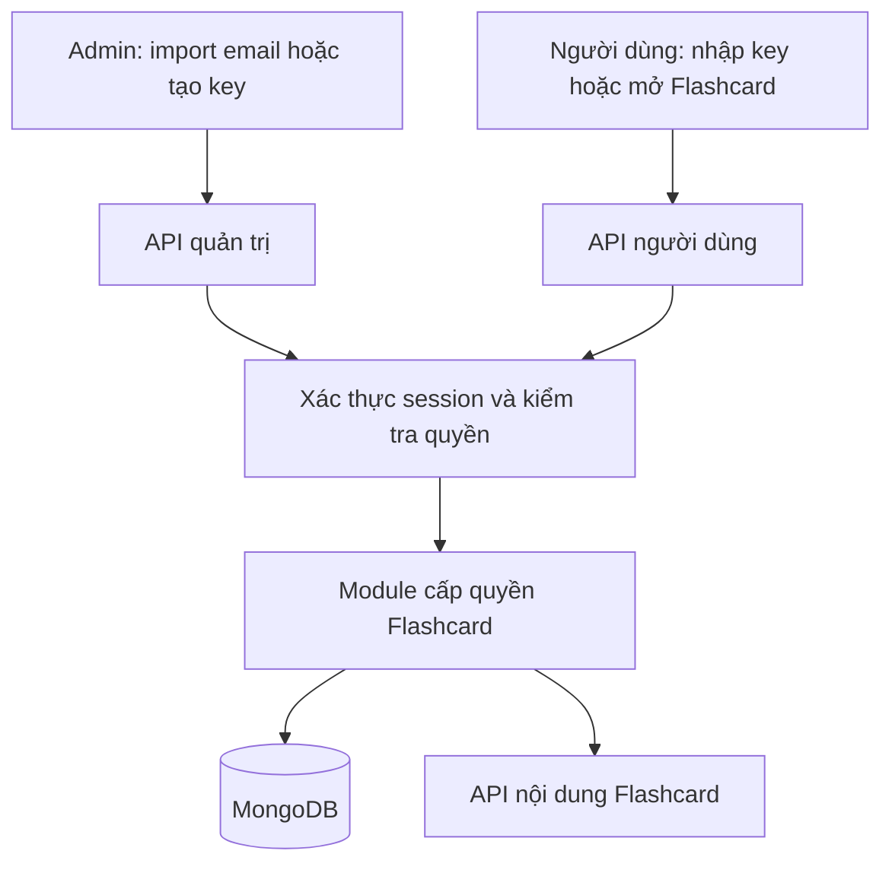

Mình đã khảo sát tài liệu kiến trúc, MongoDB và OWASP, rồi đối chiếu với code hiện tại. **Mình đề xuất dùng một backend chia module rõ ràng, với quyền Flashcard được lưu riêng theo tài khoản.** Hai cách cấp quyền — import email và nhập key — sẽ cùng đi qua một cơ chế cấp quyền.

Theo câu trả lời của bạn, quy tắc nghiệp vụ sẽ là:

- `luphuc321@gmail.com` là admin chính.
- Key dùng một lần, sau khi đổi thì quyền gắn với tài khoản.
- Quyền mặc định không hết hạn, nhưng có thể đặt ngày hết hạn.
- Admin có thể thu hồi. Sau khi thu hồi, **chỉ admin mới cấp lại**, kể cả người dùng có key khác.
- Giai đoạn này chỉ cấp quyền Flashcard TCC.

Có một chỗ cần phân biệt: **key dùng một lần** nghĩa là một key chỉ được đổi thành công một lần; **idempotency** nghĩa là request gửi lại do mạng lỗi hoặc bấm hai lần vẫn trả về cùng kết quả, không tạo thêm quyền. Mình đề xuất có cả hai.

**Điểm cần giải quyết trước trong hệ thống hiện tại**

Code đã có session đăng nhập, vai trò `Admin/Student` và collection `Enrollment` cho quyền khóa học. Chúng ta có nền để tiếp tục.

Tuy nhiên, dữ liệu Flashcard hiện được import từ các file trong frontend. Nếu chỉ thêm kiểm tra ở trang `/flashcards`, người không có quyền vẫn có thể lấy nội dung từ JavaScript đã tải về. Vì vậy, nội dung cần bảo vệ phải được chuyển sang API; backend kiểm tra quyền trước khi trả dữ liệu. OWASP cũng khuyến nghị kiểm tra quyền trên từng request và mặc định từ chối khi chưa có quyền. [Nguồn OWASP](https://cheatsheetseries.owasp.org/cheatsheets/Authorization_Cheat_Sheet.html)

Ngoài ra, việc xác định admin chính phải dựa trên **tài khoản đã xác minh danh tính**, rồi gắn với ID ổn định. Không thể chỉ tin địa chỉ email hoặc trường `isAdmin` do trình duyệt gửi lên. Với tài khoản của bạn, mình thiên về dùng Google đã xác minh email để thiết lập owner ban đầu.

**Mô hình mình chọn cho giai đoạn này**

| Mô hình | Đánh giá cho dự án |
|---|---|
| Thêm `flashcardUnlocked` vào user | Nhanh, nhưng khó quản lý nguồn cấp, thu hồi, thời hạn và lịch sử |
| Tách quyền truy cập thành collection riêng | Phù hợp: dễ tra cứu, quản trị và mở rộng |
| Tách thành nhiều microservice | Tăng số thành phần phải vận hành, chưa có nhu cầu cụ thể để chọn |

Mình chọn phương án thứ hai, triển khai trong backend Node hiện tại. Cách tổ chức này thường gọi là **modular monolith**: một ứng dụng backend, bên trong chia module theo trách nhiệm. Tài liệu Microsoft cũng trình bày cách giữ một đơn vị triển khai nhưng tách logic thành các phần rõ ràng. Việc áp dụng cho Node ở đây là đề xuất của mình. [Nguồn kiến trúc Microsoft](https://learn.microsoft.com/en-us/dotnet/architecture/modern-web-apps-azure/common-web-application-architectures)



Trang quản trị có thể nằm tại `/admin/flashcards` trong website hiện tại. Mọi API quản trị đều kiểm tra owner ở server.

**Database nên lưu những gì?**

Mình đề xuất ba collection bổ sung cho phần cấp quyền:

| Collection | Dữ liệu chính | Mục đích |
|---|---|---|
| `accessGrants` | `userId`, `resourceKey`, `status`, `expiresAt`, nguồn cấp | Trạng thái quyền hiện tại |
| `redemptionKeys` | Hash của key, trạng thái, người đổi, thời hạn đổi | Quản lý key dùng một lần |
| `accessEvents` | Ai thực hiện, thao tác gì, tài khoản nào, thời điểm, lý do | Lịch sử cấp và thu hồi |

Ví dụ quyền hiện tại:

```json
{
  "userId": "ID_TAI_KHOAN",
  "resourceKey": "flashcards:tcc",
  "status": "ACTIVE",
  "expiresAt": null,
  "source": "ADMIN_IMPORT"
}
```

`expiresAt: null` nghĩa là không hết hạn. Khi cần cấp theo đợt, trường này chứa ngày hết hạn.

Điểm quan trọng là:

- Email dùng để tìm tài khoản lúc import; quyền được lưu theo `userId`.
- Unique index trên `(userId, resourceKey)` ngăn tạo trùng quyền.
- Unique index trên `keyHash` ngăn trùng key.
- Trạng thái thu hồi được giữ lại để hệ thống biết rằng chỉ admin được cấp lại.

MongoDB hỗ trợ kết hợp unique index và validation để bảo vệ quy tắc ở database, thay vì chỉ dựa vào câu lệnh `if` trong code. [Nguồn MongoDB](https://www.mongodb.com/docs/manual/tutorial/unique-indexes-schema-validation/)

**Luồng import JSON của admin**

JSON nên đơn giản vì đây là danh sách cấp quyền:

```json
{
  "version": 1,
  "emails": [
    "sinhvien1@gmail.com",
    "sinhvien2@gmail.com"
  ]
}
```

Server tự xác định tài nguyên là `flashcards:tcc`; file này không được dùng để chỉ định vai trò admin.

Luồng mình đề xuất:

1. Admin tải file lên.
2. Server kiểm tra định dạng, email trùng và tài khoản tương ứng bằng truy vấn theo lô.
3. Hiển thị bản xem trước: **sẽ cấp mới / đã có quyền / đã bị thu hồi / email chưa tồn tại**.
4. Admin xác nhận, server kiểm tra lại và ghi dữ liệu.

**Email chưa tồn tại sẽ được báo đúng từng dòng, không tự tạo tài khoản.** Mặc định mình đề xuất yêu cầu sửa các dòng lỗi trước khi xác nhận. Trường hợp đã bị thu hồi cần thao tác “Cấp lại” rõ ràng để tránh import nhầm làm mở lại quyền.

Gửi lại cùng danh sách sẽ không tạo thêm quyền hay tự thay đổi thời hạn của quyền đang có.

**Luồng nhập key của người dùng**

Người dùng đăng nhập → nhập key → backend kiểm tra key và quyền hiện tại → ghi nhận đổi key → cấp quyền.

Có ba trường hợp đáng chú ý:

| Trường hợp | Kết quả đề xuất |
|---|---|
| Key hợp lệ, tài khoản chưa được cấp | Cấp quyền và đánh dấu key đã dùng |
| Request thành công nhưng mạng lỗi, người đó gửi lại | Trả kết quả đã kích hoạt cho chính người đó |
| Tài khoản đã bị admin thu hồi | Từ chối đổi key, yêu cầu liên hệ admin |

Nếu tài khoản đang có quyền, hệ thống báo “Bạn đã có quyền truy cập”, không tiêu thêm một key.

**Đánh dấu key đã dùng và cấp quyền phải nằm trong cùng transaction.** Nếu hai người cùng nhập một key, điều kiện cập nhật chỉ cho một người nhận key; nếu ghi quyền thất bại, thao tác đổi key cũng phải hoàn tác. MongoDB cung cấp transaction cho thay đổi trên nhiều document. [Nguồn MongoDB](https://www.mongodb.com/docs/manual/core/transactions/)

Key nên được tạo bằng bộ sinh ngẫu nhiên mật mã, chỉ lưu hash và hiển thị giá trị gốc lúc tạo. Đây là cách mình vận dụng nguyên tắc bảo vệ token của OWASP cho mã kích hoạt; tài liệu gốc nói về token khôi phục mật khẩu. [Nguồn OWASP](https://cheatsheetseries.owasp.org/cheatsheets/Forgot_Password_Cheat_Sheet.html)

Cũng cần tách rõ **hạn đổi key** và **hạn sử dụng Flashcard**: key có thể hết hạn đổi sau một ngày nhất định, nhưng quyền được cấp vẫn có thể không hết hạn.

**Với 100–1.000 người dùng, tối ưu ở đâu?**

Số tài khoản chưa đủ để kết luận cấu hình hosting có đáp ứng hay không. Cần biết bao nhiêu người học đồng thời, mỗi lượt học gọi API bao nhiêu lần và kích thước nội dung.

Với giai đoạn đầu, mình đề xuất:

- Tải bộ thẻ theo chuyên đề; lật thẻ diễn ra trên trình duyệt, không gọi API cho từng lần lật.
- Tra quyền bằng index `(userId, resourceKey)` trên mỗi request nội dung.
- Import email bằng truy vấn theo lô, giới hạn kích thước file và số dòng.
- Lưu quyền và key trong MongoDB; database lỗi thì báo tạm thời không dùng được, không chuyển quyền sang file JSON local.
- Giữ tiến độ học trên thiết bị ở bước đầu, nhưng phân vùng theo tài khoản để hai người dùng chung máy không lẫn dữ liệu.
- Đo thời gian phản hồi p95, lỗi, CPU/RAM và truy vấn trước khi thêm cache hoặc nhiều backend instance.

MongoDB có `explain("executionStats")` để xem truy vấn có dùng index và phải đọc bao nhiêu document. Đây là bằng chứng cần có khi nói “đã tối ưu database”. [Nguồn MongoDB](https://www.mongodb.com/docs/manual/tutorial/analyze-query-plan/)

Thu hồi quyền sẽ chặn những lần lấy nội dung tiếp theo. Nội dung người dùng đã tải xuống thì không thể thu hồi khỏi máy họ; điều này cần được hiểu đúng khi thiết kế quyền truy cập.

Mình đề xuất tiến hành thành ba bước: **chốt mô hình quyền và danh tính admin → làm trang quản trị cùng import/key → chuyển nội dung Flashcard qua API và đo tải trên môi trường staging**. Trang admin đầu tiên chỉ cần danh sách quyền, nhập JSON, tạo key và lịch sử thao tác là đủ để bạn vận hành đợt người dùng đầu tiên.